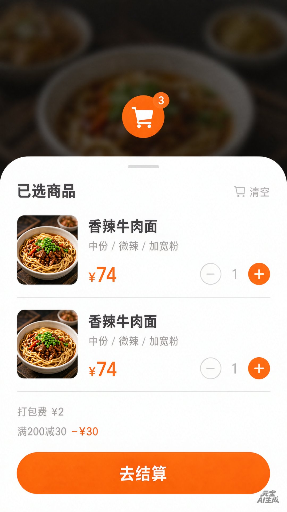
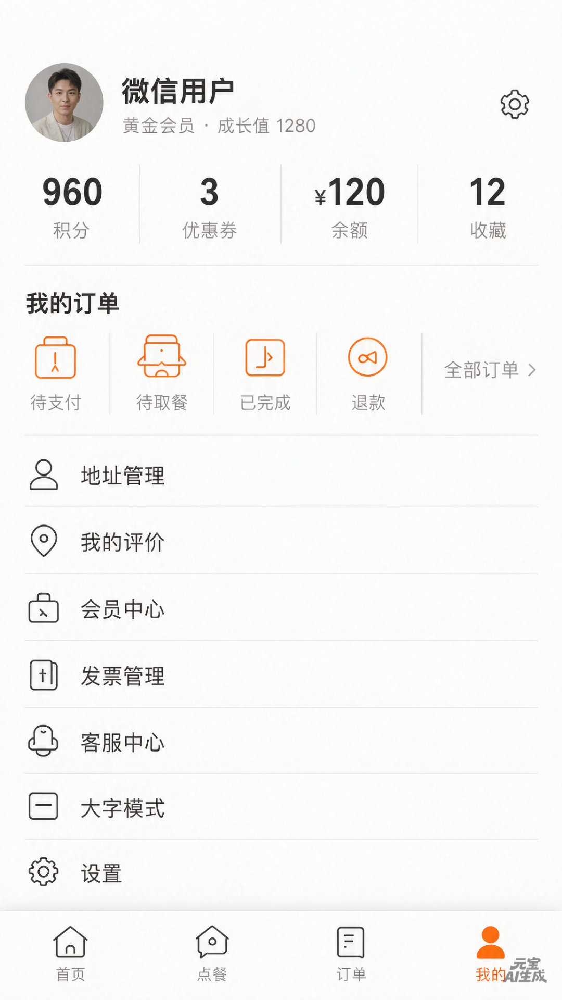
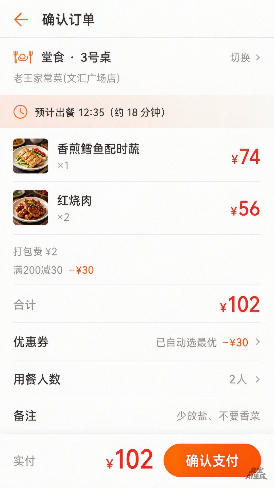
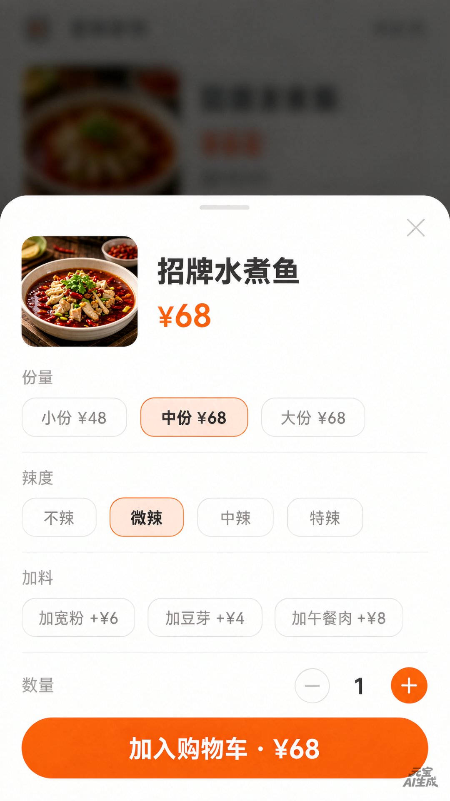
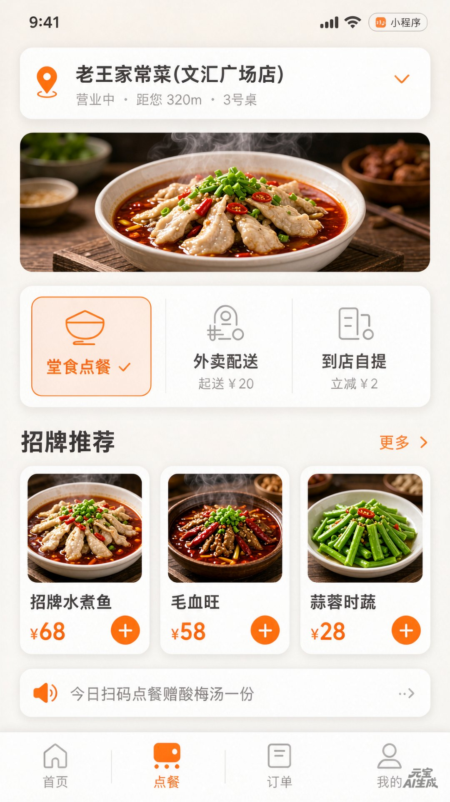
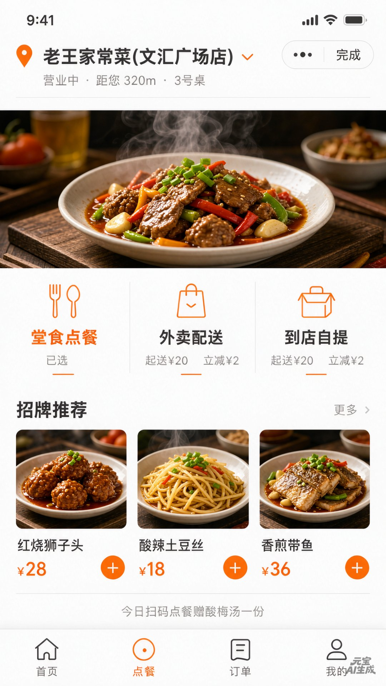
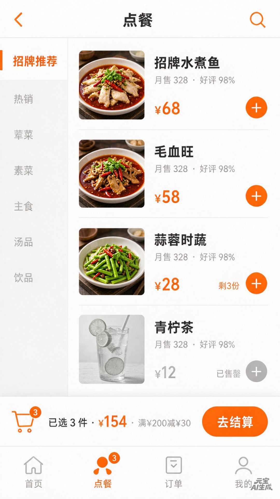

# UI 设计 · 顾客端（微信小程序）

本文档收录 Ordering 系统**顾客端小程序**的关键页面 UI 设计稿，作为前端（`Small-web/`）实现的视觉与交互参考。

> 设计版本：v1  
> 适用端：`portal: customer`（后端订单 / 支付公开接口对应的消费端）  
> 主色：赤陶橙 `#c2603c`（与 Admin-web / Merchant-web 一致，详见 `Web-shared/src/styles/tokens.scss`）

---

## 1. 购物车

底部 Tab「购物车」页面。已选商品的清单、单价、数量加减、满减提示、固定底栏「去结算」。

要点：

- 列表项包含菜品图、菜名、规格摘要（如「中份 / 微辣 / 加宽粉」）、单价、数量加减器；
- 顶部 Tab 角标用赤陶橙圆形徽章显示商品总件数；
- 满减 / 打包费等促销信息单独成行展示；
- 底栏固定显示合计金额与「去结算」主按钮，圆角胶囊。

---

## 2. 我的（用户中心）

底部 Tab「我的」页面。头像、会员等级与成长值、积分 / 优惠券 / 余额 / 收藏四项资产、订单状态快捷入口、个人功能列表。

要点：

- 顶部用户卡显示头像、等级徽章、成长值；
- 资产四宫格用大字号 + 弱化中文标签，重点呈现数字；
- 「我的订单」用四个图标按钮（待支付 / 待取餐 / 已完成 / 退款）+ 全部订单入口；
- 功能列表使用图标 + 文字的统一行高，弱化装饰。

---

## 3. 确认订单

订单确认页。展示堂食 / 外卖 / 自提的门店与桌号、预计出餐时间、明细行（含缩略规格）、打包费 / 满减、合计、优惠券、用餐人数、备注。

要点：

- 顶部显示门店与桌号，右侧「切换」可换门店或桌号；
- 预计出餐时间用时钟图标 + 「约 18 分钟」表达；
- 每行明细：菜品图、菜名、数量、右侧金额（统一右对齐，赤陶橙强调）；
- 优惠券 / 用餐人数 / 备注用可点击行触发底部弹窗；
- 底栏固定显示实付金额与「确认支付」主按钮。

---

## 4. 商品详情（规格选择）

菜品规格选择页。顶部菜品图 / 名称 / 价格；中部份量 / 辣度 / 加料的多选胶囊；底部数量加减与「加入购物车」主按钮。

要点：

- 顶图右上角关闭按钮（×）；
- 每个规格组一行，标题（如「份量 / 辣度 / 加料」）左侧、选项胶囊右侧；
- 选中项用赤陶橙实底 + 白字，未选用灰边；
- 价格随规格动态变化（加料项显示 `+¥6` 等增量）；
- 底栏固定，数量加减器居中，「加入购物车 · ¥68」主按钮圆角胶囊。

---

## 5. 首页

入口页。顶部门店图 + 营业状态 + 距您距离；中部三种点餐方式（堂食 / 外卖 / 到店自提，堂食高亮）；下部「招牌推荐」横向滚动卡片。

要点：

- 门店状态点（绿色「营业中」）、距离（320m）、桌号（3 号桌）一行展示；
- 三种点餐方式用图标 + 名称 + 价格 / 立减标签的卡片网格，堂食高亮；
- 招牌推荐用横滑卡片：菜品图 + 名称 + 价格 + 圆形「+」按钮；
- 每日扫码点餐横幅在最底部独立一条，引导分享。

---

## 6. 点餐门店（外卖）

同一门店详情，但用户选择了「外卖配送」入口。三种点餐方式里「外卖配送」高亮，下方推荐也变了（红烧狮子头 / 酸辣土豆丝 / 香煎带鱼）。

要点：

- 同一组件根据所选入口切换高亮态与下方推荐池；
- 提示词「立减 ¥2」用赤陶橙强调，视觉权重高于起送价；
- 同一卡片栅格 + 横滑推荐，**入口切换 = 内容池切换**的体验一致性。

---

## 7. 点餐页面（菜单列表）

完整菜单浏览页。左侧类目导航（招牌推荐 / 热销 / 荤菜 / 素菜 / 主食 / 汤品 / 饮品），右侧菜品卡片（销量 + 好评率 + 价格 + 「+」按钮）。

要点：

- 顶部店名 + 营业信息 + 「完成」入口（表示已下单或完成堂食点餐）；
- 左侧类目固定栏，可滚动定位到对应菜品组；
- 菜品卡片：菜品图 + 名称 + 月销 N · 好评 98% + 价格（赤陶橙）+ 圆形「+」按钮（已售罄灰禁用）；
- 底部 Tab「点餐」高亮 + 购物车角标显示已选件数 + 合计金额 + 「去结算」主按钮。

---

## 设计 Token 速查

| 用途                | 取值                       |
| ----------------- | ------------------------ |
| 主色（强调 / CTA / 价格） | `#c2603c`（赤陶橙 500）       |
| 主色浅底（胶囊选中）        | `#fdf6f3`（赤陶橙 50）        |
| 文字主               | `#241f1c`（neutral 900）   |
| 文字次               | `#857a73`（neutral 500）   |
| 描边                | `#e7e2dd`（neutral 200）   |
| 页面背景              | `#f7f5f3`（neutral 50）    |
| 圆角（胶囊 / 卡片）       | 12 px（卡片）/ 18 px（底栏 CTA） |

> 完整 Token 见 `Web-shared/src/styles/tokens.scss`，所有前端工程共享同一份设计令牌，**调整后三个端同时生效**。
